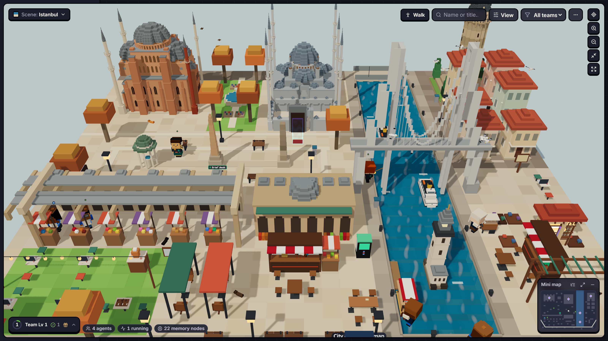
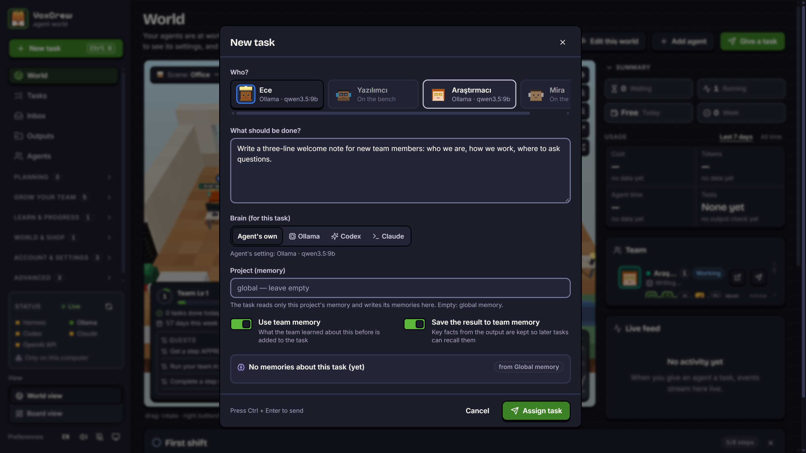
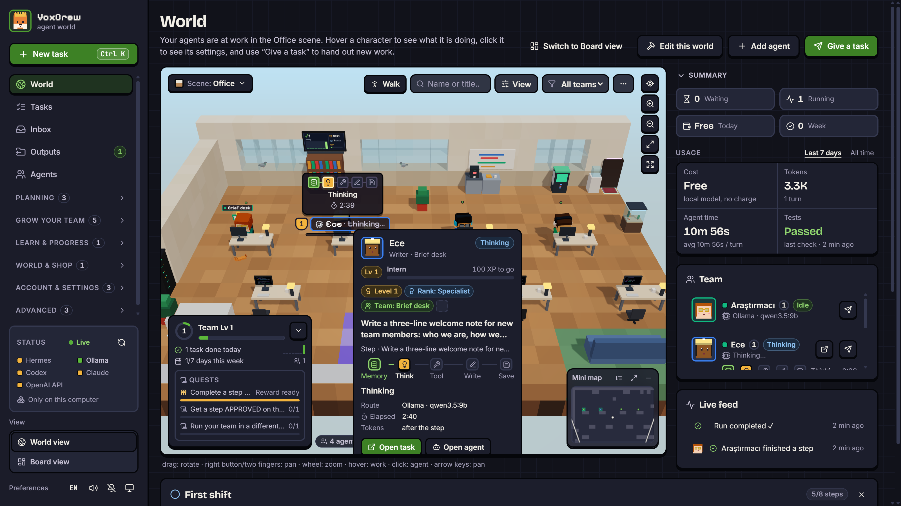

<div align="center">

# VoxCrew

### Your AI agents, as a tiny voxel crew you can watch at work

Build a crew, hand it a task, then walk through Istanbul while it gets the job done.
Everything runs on your own computer.

**English** · [Türkçe](README.tr.md)

[Quick start](#quick-start) · [How it works](#how-it-works) · [The city](#the-city) · [Brains](#brains-you-can-use) · [Privacy](#privacy-and-local-first)



</div>

## What is VoxCrew?

Most agent tools show you a log. VoxCrew shows you the crew.

Each agent is a small block-world character with a role, a brain and a set of tools. When you give it a task it gets up and goes to work: to the telescope to search the web, to the bookshelf to read, to the terminal to run commands. You see who is doing what, where a job is stuck and what it has cost, without reading a single log line.

It is a real agent workbench underneath: workflows with parallel branches and approval gates, runs you can pause and resume, a full trace of every step, and a graph memory the agents share. The city on top makes it a place you want to keep open.

This is the free edition. It runs only on your computer, needs no account and sends no telemetry.

## How it works

### 1. Build your crew

Create an agent, give it a role and pick its brain: a free local Ollama model, any OpenAI-compatible server, the Anthropic API, the Codex CLI or Claude Code. Decide which tools it may use. Two starter agents, a developer and a researcher, are ready on first launch.


### 2. Give it a task

Press **Ctrl+K** and say what you need. For bigger jobs, use a workflow: several agents in parallel, a review loop, and an approval gate where the crew waits for your yes before it goes on. Workflows are plain YAML, and four samples are included.



### 3. Watch the work happen

The agent walks to the station that matches the tool it is using and shows what it is doing right now. Pause a run, resume it, retry one step or set a budget for it. The trace view keeps every step, retry and tool call.



| Workflows | Trace | Memory |
|---|---|---|
|  |  |  |

## The city

Your crew does not live in a dashboard. It lives in a city you can walk through.

While the agents work, step outside: wander Istanbul's streets, stand under a landmark, then go and see Kapadokya. Earn your first passport stamp and Londra opens. The office is where the work is done; the city is why you leave the tab open.

| Istanbul | Kapadokya |
|---|---|
|  |  |

## What the free edition includes

| | |
|---|---|
| **3 cities** | Istanbul and Kapadokya from the start; Londra opens with your first passport stamp. |
| **2 agent seats** | Two agents active at once. Extra agents wait on the bench. A manager can hand work to existing agents but cannot hire new ones. |
| **Voxel office** | Agents sit at their desks, walk to the station for their tool and show their live status. |
| **Workflows** | Parallel branches, approval gates and review loops, saved as YAML. Samples in `workflows/` (English copies in `workflows/en/`). |
| **Durable runs** | Pause, resume, retry a step, per-run budgets, full trace. |
| **Graph memory** | An ontology-checked SQLite graph with full-text recall. Pin or invalidate facts. |
| **Two languages** | The whole interface in English and Turkish. |

**Coming soon:** more cities and plans for bigger teams. Nothing is on sale yet; the app tells you when they are ready.

<a name="quick-start"></a>
## Quick start

### Install from source

You need **Git**, **[uv](https://docs.astral.sh/uv/)** and **[Node.js](https://nodejs.org/) 20+**. If you don't have Python 3.11+, uv fetches it for you. The start script installs dependencies from the lock files (`uv sync --locked`, `npm ci`), builds the UI the first time and serves the app at **http://127.0.0.1:7420**. The first run can take a few minutes; later starts take seconds.

**Windows (PowerShell)**

```powershell
winget install --id Git.Git -e; winget install --id astral-sh.uv -e; winget install OpenJS.NodeJS.LTS   # skip what you already have
# then open a NEW PowerShell window so the new tools are on PATH
git clone https://github.com/Mucaktr/voxcrew.git "$HOME\voxcrew"
powershell -NoProfile -ExecutionPolicy Bypass -File "$HOME\voxcrew\start.ps1" -Open
```

**macOS**

```sh
brew install git uv node        # skip what you already have
git clone https://github.com/Mucaktr/voxcrew.git ~/voxcrew
sh ~/voxcrew/start.sh --open
```

**Linux**

```sh
curl -LsSf https://astral.sh/uv/install.sh | sh   # then open a new terminal
# Node.js 20+: if your distribution's package is older, use the installer from nodejs.org (check with node --version)
git clone https://github.com/Mucaktr/voxcrew.git ~/voxcrew
sh ~/voxcrew/start.sh --open
```

The start scripts stop with a short `ERROR:` message if a step fails. Press **Ctrl+C** in the terminal to stop the app. Use another port with `-Port 7430` / `--port 7430` (or set `STUDIO_PORT`). After a `git pull`, add `-Rebuild` / `--rebuild` to rebuild the UI.

**First launch.** After a one-question 18+ confirmation (stored only on your computer), a setup wizard shows which tools it found and lets you pick a scene. It introduces the two starter agents, *Yazılımcı* (developer) and *Araştırmacı* (researcher), and gives each one the first brain it can find. If you have no brain yet, open **Connections**: you can start Ollama, download a model that suits your hardware, or connect a local OpenAI-compatible server. Then press **Ctrl+K** and give your first task. Without a brain the app still opens, but agent cards say *Beyin seçilmedi* ("no brain selected") and a workflow step stops with that message instead of running.

### Run with Docker

If you only have Docker installed, this is the shortest way:

```sh
git clone https://github.com/Mucaktr/voxcrew.git
cd voxcrew
docker compose up --build
```

The first build takes a few minutes. Then open <http://localhost:7420>. Stop it with **Ctrl+C**, or `docker compose down` if you started it in the background (`docker compose up -d --build`). Your data lives in the Docker volume `voxcrew-data` (mounted at `/data`); `docker compose down -v` deletes it. Nothing starts by itself after a reboot.

The page is published on your own computer only (`127.0.0.1:7420`). Do not change that line to `0.0.0.0`: the app has no login, it relies on being reachable from your machine alone. Inside the container the server listens on all interfaces (`STUDIO_BIND_HOST`, accepted only by the Docker image); the Host and Origin checks stay as strict as in a normal install.

**Local models (Ollama on your computer).** The container cannot see your computer's `127.0.0.1`. On Docker Desktop (Windows, macOS) set `OLLAMA_HOST: "http://host.docker.internal:11434"` in `docker-compose.yml`. On Linux also uncomment the `extra_hosts: host.docker.internal:host-gateway` lines there. Ollama listens on `127.0.0.1` by default, so you may have to start it with `OLLAMA_HOST=0.0.0.0` on the host, which also opens it to your local network; use a firewall for that. This path has not been tested end to end. Alternatively, connect an OpenAI-compatible server on your network in **Connections**.

**What does not work inside the container.** The image has no Claude Code, Codex, Gemini CLI or Hermes, and the container cannot start programs on your computer. So those "brains" are not offered, and the setup wizard cannot start or install Ollama for you. Webhook and ingest endpoints that only accept local callers without an access key will refuse requests coming from your host (Docker makes them look non-local); give them an access key. For Claude Code or Codex as brains, use the normal install.

## Brains you can use

| Brain | Cost | How it connects |
|---|---|---|
| [Ollama](https://ollama.com/) | Free, runs locally | Live model list. Downloads a recommended model sized to your hardware after you confirm. |
| OpenAI-compatible endpoints | Free locally, or your own API key | Several named endpoints at once, each with its own masked key and model (LM Studio, llama.cpp, vLLM, Mistral, Gemini, OpenRouter and others). |
| Anthropic API | Your own API key | Direct Messages API with your key, billed separately from a Claude Code plan. |
| [Codex CLI](https://github.com/openai/codex) | Your ChatGPT / Codex plan | Uses your existing `codex` login. Read-only by default. |
| [Claude Code](https://docs.anthropic.com/en/docs/claude-code) | Your Claude plan | Uses your existing `claude` login. Read tools only by default. |
| [Hermes Agent](https://github.com/NousResearch/hermes-agent) (optional) | Free, open source | Adds profiles, skills and toolsets. VoxCrew works fully without it. |

Model cost is not included in VoxCrew: you pay hosted models directly to their provider. Local Ollama models are free.

**Tool rules are not enforced the same way for every brain.** Per-tool allow/deny rules are enforced for local models (the studio runs the tools itself) and for Claude Code (passed as `--disallowedTools`). The Codex CLI and Hermes have no per-tool switch, so those rules are **not** enforced for them; Codex is limited only by its sandbox. OpenAI-compatible endpoints get no tools. The Tools page shows this per agent.

## Privacy and local-first

- **Local only.** The server binds to `127.0.0.1` and has no `--host` option. Requests with a non-loopback Host are rejected (DNS rebinding), and so are cross-site state-changing requests (CSRF).
- **No account, no telemetry.** VoxCrew contacts only the brains and endpoints you set up: a hosted CLI or API endpoint you chose (which sends your prompts to that provider), Ollama model downloads you click, and an OTLP endpoint if you configure one.
- **Your data stays in your data directory**, never inside the repository: `%LOCALAPPDATA%\VoxCrew` on Windows, `~/Library/Application Support/VoxCrew` on macOS, `$XDG_DATA_HOME/voxcrew` on Linux. Override it with `STUDIO_DATA_DIR`.
- **No silent config edits.** Changes to Hermes, Claude or Codex settings are shown to you first, backed up and written only after you confirm.
- **Task text, web pages and agent output are treated as data.** They cannot change an agent's permissions or approve anything. A model can still be misled into misusing the permissions you gave it, so give write access only where you need it.
- **18+.** VoxCrew is meant for adults. The first-run confirmation is stored only on your computer.

More on the threat model and private vulnerability reporting: [SECURITY.md](SECURITY.md).

## Known limits

- This is an early release and a single-user app: no remote access, no multi-user login.
- You need uv and Node to build it from source. There are no prebuilt installers yet.
- The sample workflows, the starter agents' default names and a few rarely seen server messages are Turkish only. English copies of the sample workflows are in `workflows/en/`; copy them into your data directory's `workflows/` folder to use them.
- Hosted brains are bound by their own quotas. VoxCrew shows how much they are used but cannot lift any limit.

## Environment variables

| Variable | Default | Purpose |
|---|---|---|
| `STUDIO_PORT` | `7420` | Server port (read by the start scripts) |
| `STUDIO_DATA_DIR` | platform data dir | Graph database, settings, user workflows, working folder |
| `STUDIO_WORKDIR` | `<data dir>/workspace` | Folder where agents read and write files |
| `HERMES_HOME` | `~/.hermes` | Hermes Agent home |
| `OLLAMA_HOST` | `127.0.0.1:11434` | Ollama address |
| `STUDIO_ALLOWED_HOSTS` | none | Extra Host names, comma separated (trusted local names only) |
| `STUDIO_MAX_BODY_BYTES` | `4194304` | Request body limit |

## Contact and license

Questions and bug reports: mustafa.ucak@gmail.com. By Mustafa Uçak. This edition is licensed under the [PolyForm Shield License 1.0.0](https://polyformproject.org/licenses/shield/1.0.0); the full text is in [LICENSE](LICENSE); third-party components and font licenses are listed in [THIRD_PARTY_NOTICES.md](THIRD_PARTY_NOTICES.md).

VoxCrew is not affiliated with Nous Research, OpenAI, Anthropic or Ollama. Hermes, Codex, ChatGPT, Claude, Claude Code and Ollama are trademarks of their respective owners. They are named here only to describe compatibility.
