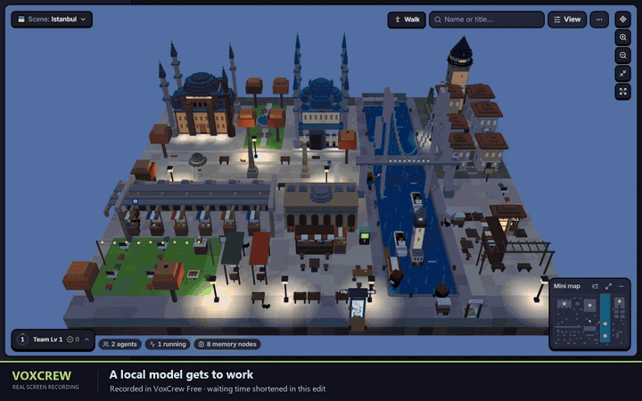
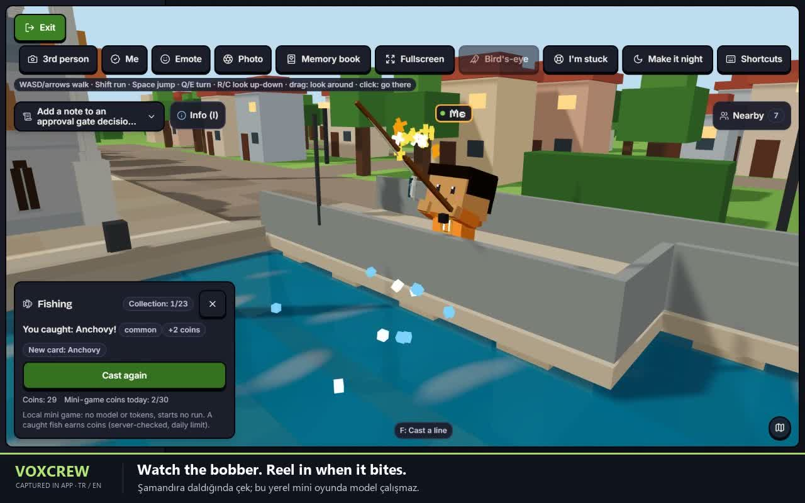
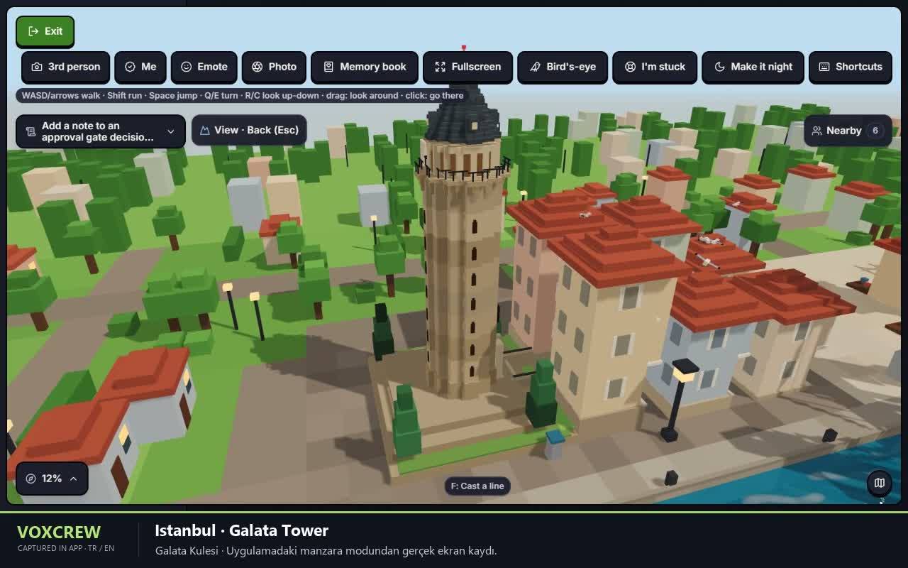
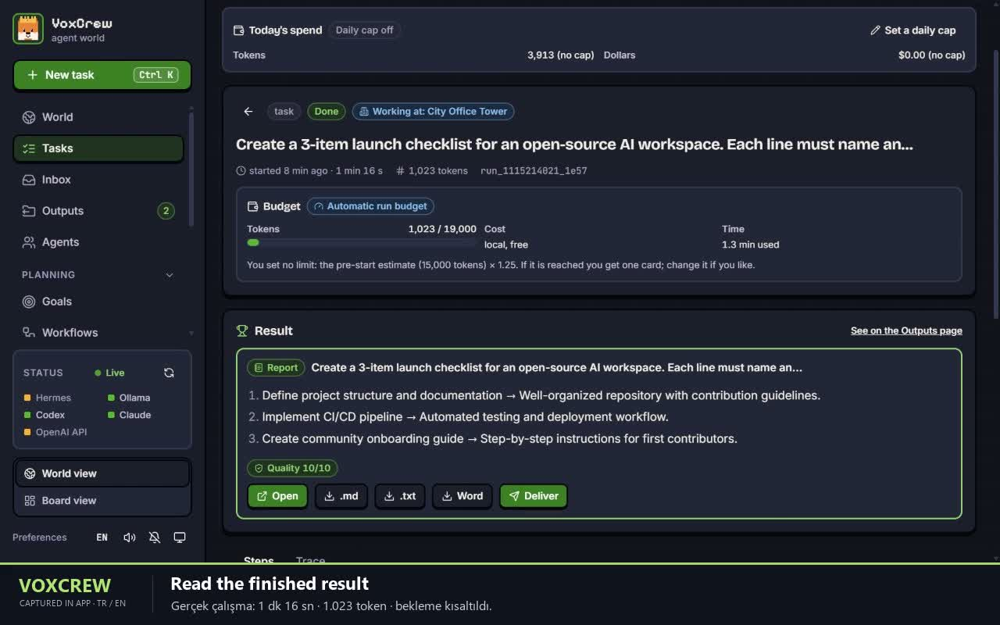
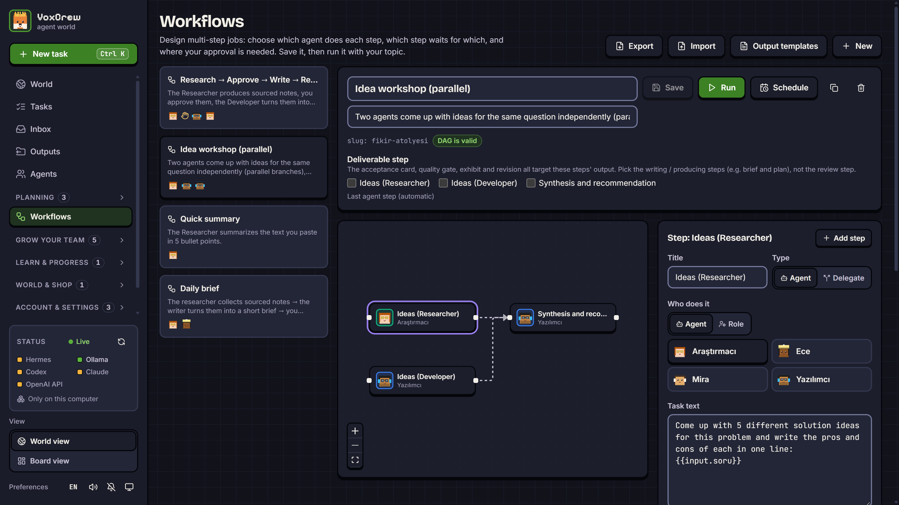
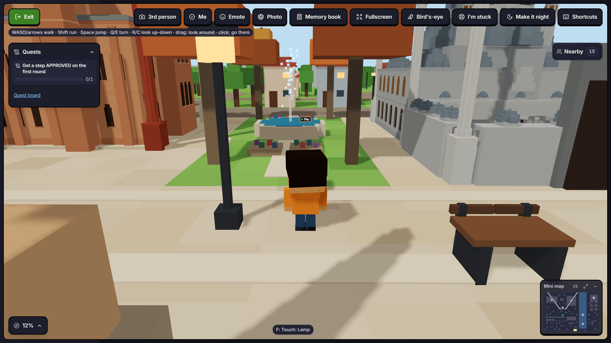
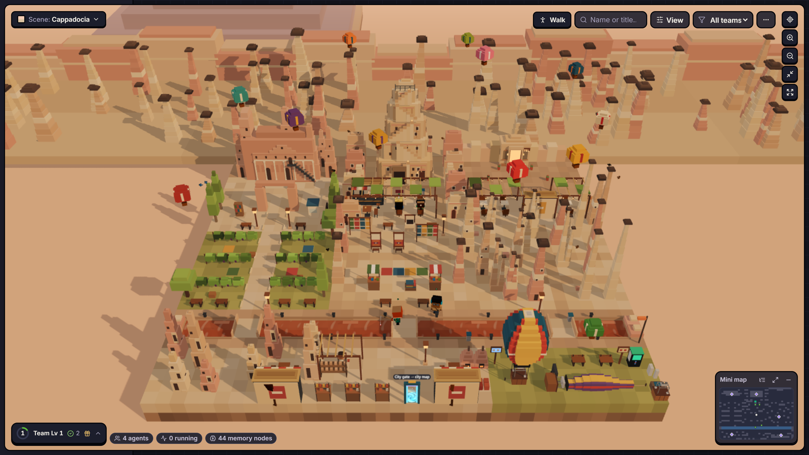
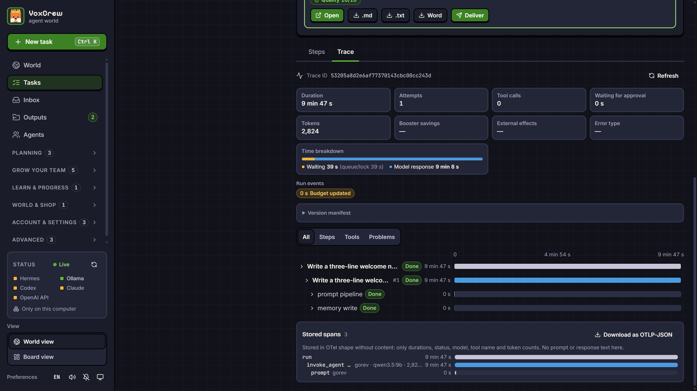
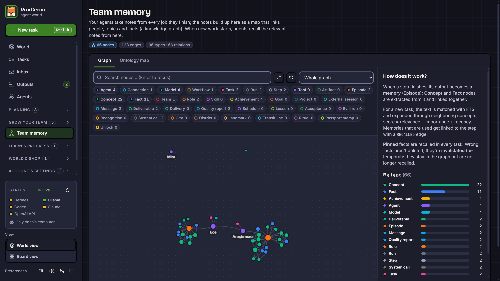

<div align="center">

# VoxCrew

### Give your AI agents a world to work in.

A local-first visual workspace for your AI crew. Connect Ollama, Codex CLI, Claude Code or your own model endpoint, run workflows, and follow your agents in a voxel world.

**Early release · 2 active agents · Windows / macOS / Linux · English / Türkçe**

**[Get started](#quick-start)** · [Choose a model](#brains-you-can-use) · [Ask a question](https://github.com/Mucaktr/voxcrew/discussions) · [Türkçe](README.tr.md)

[](docs/media/voxcrew-demo.mp4)

**[Watch / download the 42-second demo (MP4)](docs/media/voxcrew-demo.mp4?raw=1)** · [Demo details](docs/media/DEMO.md)

A real summary task with **Ollama qwen3:4b**, followed by a tour of Istanbul, Cappadocia and London. The task took **3 min 41 sec**; this **42-second edit** shortens the waiting.

</div>

VoxCrew runs on your computer. Use a local model or connect a hosted provider with your own account. **No VoxCrew account is required. Hosted models and network tools can send data outside your computer.**

## What you can do

- **Follow your crew:** see agent status and tool activity in a voxel office, then explore Istanbul, Cappadocia and London.
- **Run repeatable work:** combine parallel tasks, your approval and review loops in YAML workflows.
- **Inspect a run:** pause, resume, retry a step, set a budget and review its trace.
- **Keep shared context:** use a local SQLite graph with full-text recall, pinned facts and invalidation.

Built for individual developers and AI tinkerers who want a visual way to work with their existing models. This is an early, single-user release; see the [free-edition limits](#free-edition-and-current-limits).

## More videos

Three screen recordings from the public free edition. Click a preview to open the video. Each clip has English and Turkish captions and no audio.

| Take a break · 40 sec | Explore the landmarks · 36 sec | Meet your crew · 81 sec |
|---|---|---|
| [](docs/media/voxcrew-breaks-40s.mp4) | [](docs/media/voxcrew-landmarks-36s.mp4) | [](docs/media/voxcrew-agent-menus-81s.mp4) |
| Catch an anchovy, sip tea by the Bosphorus and share a simit with the seagulls. | Visit Galata Tower, the Bosphorus Bridge, Maiden's Tower, Cappadocia's fairy chimneys and London's riverside landmarks. | Choose a model, assign a real task, inspect its result and trace, then explore workflows, scheduling, shared memory, the inbox and output controls. |
| [Watch / download MP4](docs/media/voxcrew-breaks-40s.mp4?raw=1) · [Subtitles](docs/media/voxcrew-breaks-40s.srt) | [Watch / download MP4](docs/media/voxcrew-landmarks-36s.mp4?raw=1) · [Subtitles](docs/media/voxcrew-landmarks-36s.srt) | [Watch / download MP4](docs/media/voxcrew-agent-menus-81s.mp4?raw=1) · [Subtitles](docs/media/voxcrew-agent-menus-81s.srt) |

The agent video includes a completed **Ollama qwen3:4b** task: **1 min 16 sec**, with **1,023 tokens** reported by the app. Waiting is shortened in the edit. The workflow editor, scheduling and export options are previews; the result is actually pinned.

## Quick start

Install **[Git](https://git-scm.com/downloads)**, **[uv](https://docs.astral.sh/uv/getting-started/installation/)** and **[Node.js 20+](https://nodejs.org/)**. Open a new terminal afterward. uv can install Python 3.11+ if needed.

```sh
git clone https://github.com/Mucaktr/voxcrew.git
cd voxcrew
```

**Windows — PowerShell**

```powershell
powershell -NoProfile -ExecutionPolicy Bypass -File .\start.ps1 -Open
```

**macOS / Linux**

```sh
sh ./start.sh --open
```

The first launch installs locked dependencies and builds the UI. Open **<http://127.0.0.1:7420>** if the browser does not open automatically. Stop the server with **Ctrl+C**.

**The app opens without a model. Running an agent requires a working model connection.** Local Ollama needs a downloaded model and sufficient hardware; hosted providers use their own accounts, quotas and billing.

[Full setup guide: prerequisites, Docker, updates and troubleshooting →](docs/SETUP.md)

### Get your first result

1. Complete the local 18+ confirmation and setup wizard. Switch the interface language to English if needed.
2. In **Connections**, check your model is ready. In **Agents**, assign it to **Researcher** and review its permissions.
3. Press **Ctrl+K**, select **Researcher**, and paste this example:

```text
Summarize the text below in three bullet points. Use only this text;
do not browse the web or modify files.

Our team is preparing a product demo for Friday. The prototype is ready.
We still need to check the installation guide and record a short walkthrough.
Alex will check the guide. Sam will record the walkthrough on Thursday.
```

4. Open the run to inspect its output and trace. Expect a short summary of the supplied text; quality depends on your model.

The starter **Developer** has write permission in the work folder. **Researcher** starts with read permission. Check your selected brain's permission behavior before using real project files.

## Try the included workflows

Three examples are included in both languages. English UI requests load the English examples automatically; your own workflows are not translated.

| Workflow | What it demonstrates |
|---|---|
| [Quick summary](workflows/en/hizli-ozet.yaml) | Paste text and ask Researcher for five short bullet points. |
| [Idea workshop](workflows/en/fikir-atolyesi.yaml) | Two parallel idea lists, followed by a combined recommendation. |
| [Research → Approve → Write → Review](workflows/en/arastir-ve-yaz.yaml) | Research notes, your approval, a draft and a bounded review loop. Research needs suitable tools and source checking. |

| Agent activity | Workflow editor |
|---|---|
|  |  |

<details>
<summary>See the city, trace and shared memory</summary>

| City walk | Cappadocia |
|---|---|
|  |  |

| Run trace | Shared memory |
|---|---|
|  |  |

Screenshots show example configurations. The free edition allows two active agents; additional agents wait on the bench.

</details>

## Brains you can use

| Connection | What you bring | Tool behavior |
|---|---|---|
| [Ollama](https://ollama.com/) | A local model that fits your hardware | Tool-capable models use VoxCrew's tool bridge when tools or skills are assigned. |
| OpenAI-compatible server or API | A running local endpoint, or a hosted endpoint and API key | Tool support depends on the model, endpoint and assigned MCP tools or skills. |
| Anthropic API | Your own API key | Direct Messages API; separate from a Claude Code account. Tools depend on configuration. |
| [Codex CLI](https://github.com/openai/codex) | Installed CLI and working login | Agent permissions select the sandbox; this connector does not enforce VoxCrew's per-tool deny list. |
| [Claude Code](https://code.claude.com/docs/en/overview) | Installed CLI and working login | Connector passes per-tool restrictions to Claude Code. |
| [Hermes Agent](https://github.com/NousResearch/hermes-agent) (optional) | Existing installation, profile and model access | Uses Hermes tools and configuration; this connector does not enforce VoxCrew's per-tool deny list. |

VoxCrew does not include hosted model usage. Provider charges and quotas still apply. A fully local setup requires local models **and** local tools; choosing Ollama alone does not make a web tool offline.

## Free edition and current limits

| Included | Limit or behavior |
|---|---|
| Active crew | 2 agents; extra agents remain on the bench. |
| Built-in cities | Istanbul and Cappadocia; London unlocks with your first passport stamp. |
| Saved custom workflows | 5; bundled examples are separate. |
| Active schedules / custom worlds | 1 schedule / 3 custom worlds. |
| Remote API connections | 1 named remote connection; local OpenAI-compatible endpoints are exempt from this quota. |
| Languages | English and Turkish UI and starter examples; some uncommon server messages may remain Turkish. |
| Installation | Source or Docker; no prebuilt desktop installers yet. |

This edition is single-user and local-only. Keep it bound to loopback; it has no multi-user login. Docker has additional CLI and networking limits in the [setup guide](docs/SETUP.md#docker).

## Privacy and permissions

- Settings, workflows and memory are stored in your local data directory. See [data locations](docs/SETUP.md#data-and-environment-variables).
- No usage telemetry is sent by default. Hosted models, network tools, model downloads and an explicitly configured OTLP exporter can make network requests.
- Review tool and file permissions before running an agent. Task text and model output are not permission grants; model instructions alone are not a security boundary.
- Changes to supported external CLI settings use a preview, confirmation, backup and undo flow.

Read the [security policy](SECURITY.md) for boundaries and private vulnerability reporting.

## Help shape VoxCrew

- **First time trying it?** [Ask in Discussions](https://github.com/Mucaktr/voxcrew/discussions) with your OS, chosen brain and where setup got stuck. Remove secrets and personal paths.
- **Bug or feature idea?** [Open an issue](https://github.com/Mucaktr/voxcrew/issues/new/choose).
- **Want to contribute?** Start with [documentation, translations or exported worlds](CONTRIBUTING.md#good-first-contributions).
- **Want to follow development?** Star the repository to bookmark it and share a workflow you found useful.

## License

By Mustafa Uçak. Source is available under the **[PolyForm Shield License 1.0.0](LICENSE)**, which includes a noncompete restriction. Review the license before using or distributing the software. See [third-party notices](THIRD_PARTY_NOTICES.md).

VoxCrew is not affiliated with Nous Research, OpenAI, Anthropic or Ollama. Product names identify compatibility; their trademarks belong to their respective owners.
