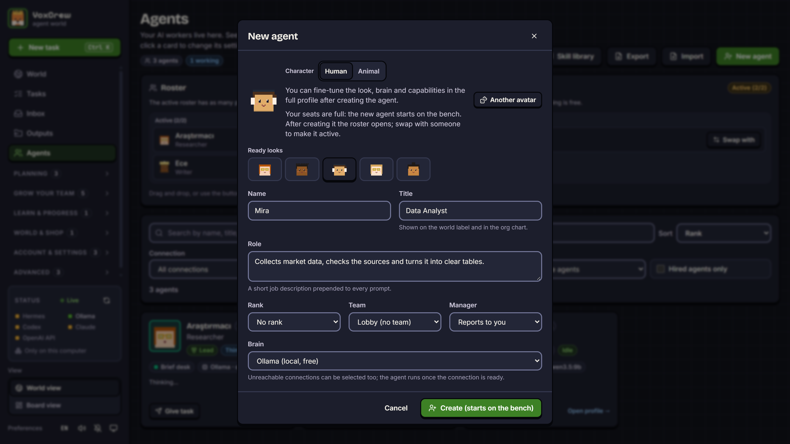
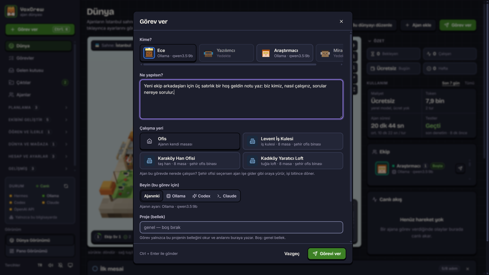
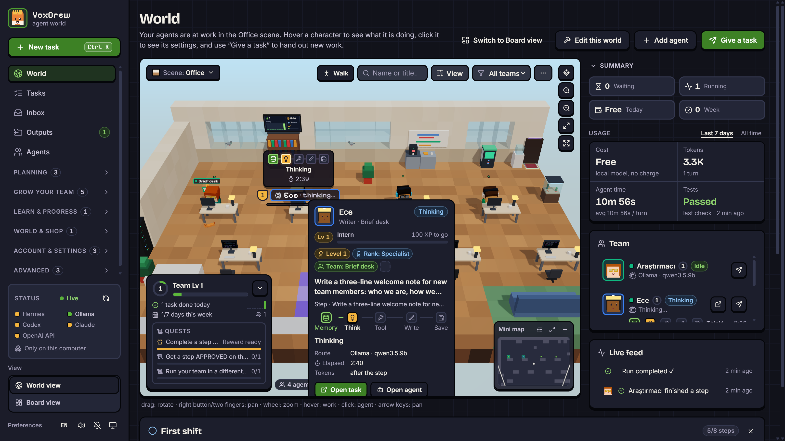
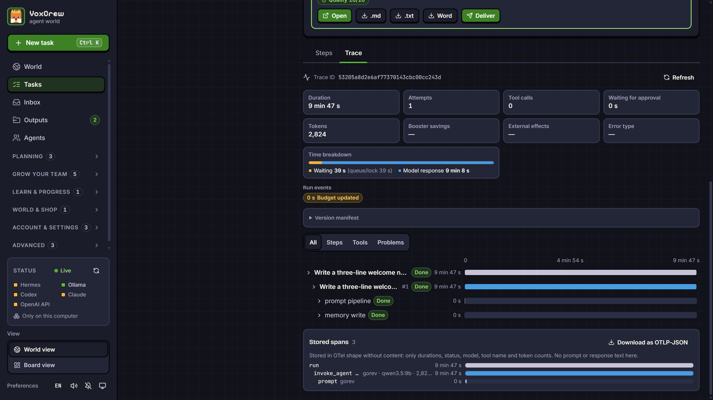
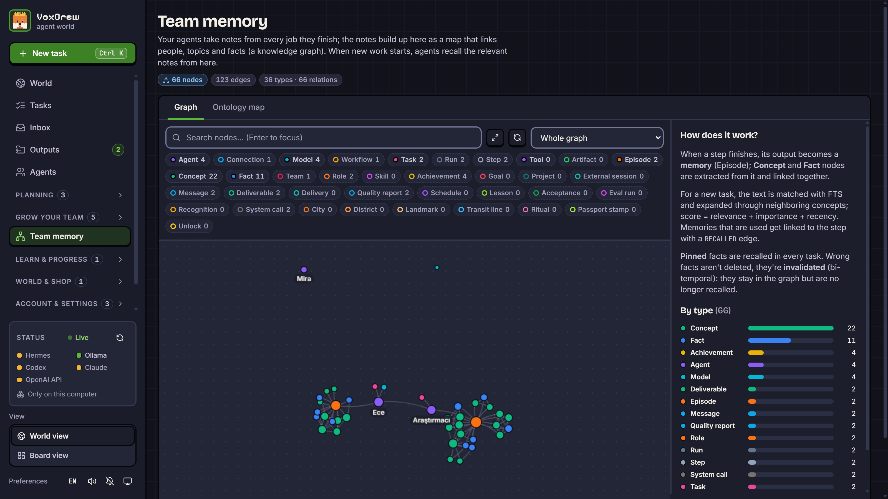
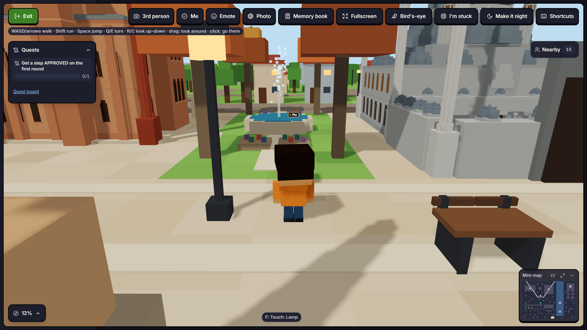
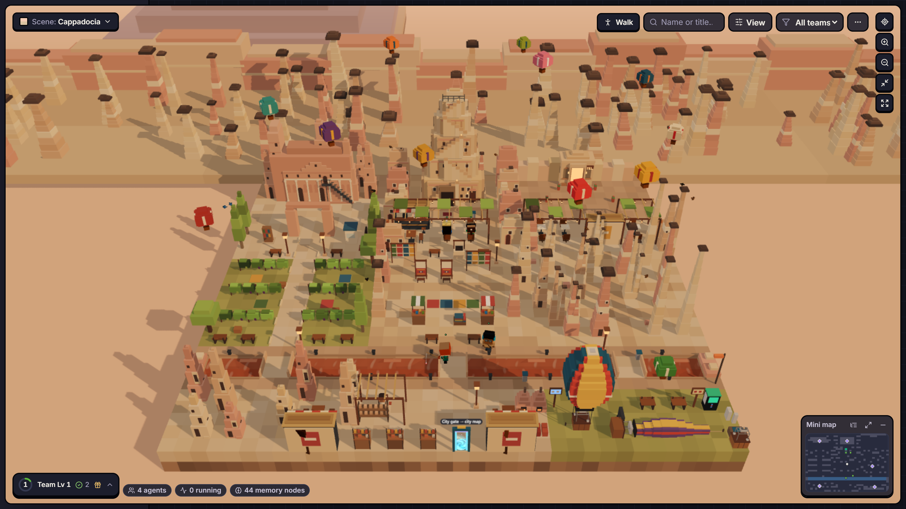

<div align="center">

# VoxCrew

### Yapay zekâ ajanların, çalışırken izleyebileceğin küçük bir voksel ekip

Ekibini kur, işi ver, onlar çalışırken İstanbul'da dolaş.
Her şey kendi bilgisayarında çalışır.

[English](README.md) · **Türkçe**

[Hızlı başlangıç](#hizli-baslangic) · [Nasıl çalışır](#nasıl-çalışır) · [Şehir](#şehir) · [Beyinler](#kullanabileceğin-beyinler) · [Gizlilik](#gizlilik-ve-önce-yerel)


</div>

## VoxCrew nedir?

Ajan araçlarının çoğu sana bir kayıt dökümü gösterir. VoxCrew ekibin kendisini gösterir.

Her ajan blok dünyasında küçük bir karakter: bir rolü, bir beyni ve kullanabildiği araçlar var. İş verdiğinde kalkar ve işe koyulur. Web'de aramak için teleskopa, okumak için kitaplığa, komut çalıştırmak için terminale yürür. Kim ne yapıyor, iş nerede takıldı, kaça mal oldu; tek satır kayıt okumadan görürsün.

Altında gerçek bir ajan tezgâhı var: paralel dalları ve onay kapıları olan iş akışları, durdurup devam ettirebildiğin koşular, her adımın izi ve ajanların ortak kullandığı bir graf bellek. Üstündeki şehir de sekmeyi açık tutmak için güzel bir sebep.

Bu, ücretsiz sürüm. Yalnızca senin bilgisayarında çalışır, hesap istemez, telemetri göndermez.

## Nasıl çalışır

### 1. Ekibini kur

Bir ajan oluştur, rolünü ver, beynini seç: ücretsiz yerel bir Ollama modeli, OpenAI uyumlu herhangi bir sunucu, Anthropic API, Codex CLI ya da Claude Code. Hangi araçları kullanabileceğine sen karar verirsin. İlk açılışta iki hazır ajan gelir: bir yazılımcı, bir araştırmacı.



### 2. İşi ver

**Ctrl+K**'ya bas ve ne istediğini yaz. Daha büyük işler için iş akışı kullan: birkaç ajan aynı anda çalışır, biri diğerinin işini gözden geçirir, onay kapısında ekip senden "tamam" bekler. İş akışları düz YAML dosyalarıdır; dört örnek hazır gelir.



### 3. İşin yapılışını izle

Ajan, kullandığı araca uygun istasyona yürür ve o an ne yaptığını gösterir. Koşuyu durdur, devam ettir, tek bir adımı yeniden dene ya da bütçe koy. İz görünümü her adımı, yeniden denemeyi ve araç çağrısını saklar.



| İş akışları | İz | Bellek |
|---|---|---|
|  |  |  |

## Şehir

Ekibin bir panoda yaşamıyor. İçinde yürüyebildiğin bir şehirde yaşıyor.

Ajanlar çalışırken dışarı çık: İstanbul sokaklarında dolaş, bir yapıtın önünde dur, sonra Kapadokya'ya geç. İlk pasaport damganı kazanınca Londra da açılır. İş ofiste yapılır; şehir, sekmeyi kapatmamanın sebebidir.

| İstanbul | Kapadokya |
|---|---|
|  |  |

## Ücretsiz sürümde neler var

| | |
|---|---|
| **3 şehir** | İstanbul ile Kapadokya baştan açık; Londra ilk pasaport damganla açılır. |
| **2 ajan koltuğu** | Aynı anda iki ajan aktif olur, fazlası yedekte bekler. Yönetici işi var olan ajanlara devredebilir ama yeni ajan işe alamaz. |
| **Voksel ofis** | Ajanlar masalarında oturur, aracına uygun istasyona yürür, o an ne yaptığını gösterir. |
| **İş akışları** | Paralel dallar, onay kapıları, gözden geçirme döngüleri; YAML olarak saklanır. Örnekler `workflows/` klasöründe (İngilizceleri `workflows/en/` içinde). |
| **Kesintiye dayanıklı koşular** | Durdur, devam ettir, adımı yeniden dene, koşu başına bütçe, tam iz. |
| **Graf bellek** | Ontoloji denetimli, tam metin aramalı bir SQLite grafı. Bilgileri sabitle ya da geçersiz kıl. |
| **İki dil** | Arayüzün tamamı Türkçe ve İngilizce. |

**Yakında:** yeni şehirler ve büyük ekipler için paketler. Şu an satışta bir şey yok; hazır olduklarında uygulama haber verir.

<a name="hizli-baslangic"></a>
## Hızlı başlangıç

### Kaynaktan kurulum

**Git**, **[uv](https://docs.astral.sh/uv/)** ve **[Node.js](https://nodejs.org/) 20+** gerekir. Python 3.11+ yoksa uv onu da indirir. Başlatma betiği bağımlılıkları kilit dosyalarından kurar (`uv sync --locked`, `npm ci`), arayüzü ilk seferde derler ve uygulamayı **http://127.0.0.1:7420** adresinde açar. İlk çalıştırma birkaç dakika sürebilir, sonrası birkaç saniyedir.

**Windows (PowerShell)**

```powershell
winget install --id Git.Git -e; winget install --id astral-sh.uv -e; winget install OpenJS.NodeJS.LTS   # zaten kurulu olanları atla
# ardından yeni araçlar PATH'e girsin diye YENİ bir PowerShell penceresi aç
git clone https://github.com/Mucaktr/voxcrew.git "$HOME\voxcrew"
powershell -NoProfile -ExecutionPolicy Bypass -File "$HOME\voxcrew\start.ps1" -Open
```

**macOS**

```sh
brew install git uv node        # zaten kurulu olanları atla
git clone https://github.com/Mucaktr/voxcrew.git ~/voxcrew
sh ~/voxcrew/start.sh --open
```

**Linux**

```sh
curl -LsSf https://astral.sh/uv/install.sh | sh   # ardından yeni bir terminal aç
# Node.js 20+: dağıtımının paketi eskiyse nodejs.org'daki kurucuyu kullan (node --version ile bak)
git clone https://github.com/Mucaktr/voxcrew.git ~/voxcrew
sh ~/voxcrew/start.sh --open
```

Bir adım başarısız olursa betikler kısa bir `HATA:` iletisiyle durur. Uygulamayı durdurmak için terminalde **Ctrl+C**'ye bas. Başka port için `-Port 7430` / `--port 7430` (ya da `STUDIO_PORT`) kullan. `git pull` sonrası arayüzü yeniden derlemek için `-Rebuild` / `--rebuild` ekle.

**İlk açılış.** Tek soruluk 18+ onayından sonra (yalnızca bilgisayarında saklanır) bir kurulum sihirbazı bulduğu araçları gösterir ve bir sahne seçtirir. İki başlangıç ajanını, *Yazılımcı* ile *Araştırmacı*'yı tanıtır ve her birine bulabildiği ilk beyni verir. Henüz beynin yoksa **Bağlantılar**'ı aç: Ollama'yı başlatabilir, donanımına uygun bir model indirebilir ya da yerel bir OpenAI uyumlu sunucu bağlayabilirsin. Sonra **Ctrl+K**'ya basıp ilk görevini ver. Beyin olmadan da uygulama açılır; ancak ajan kartlarında *Beyin seçilmedi* yazar ve bir iş akışı adımı çalışmak yerine bu iletiyle durur.

### Docker ile çalıştırma

Elinde yalnızca Docker varsa en kısa yol bu:

```sh
git clone https://github.com/Mucaktr/voxcrew.git
cd voxcrew
docker compose up --build
```

İlk derleme birkaç dakika sürer. Sonra <http://localhost:7420> adresini aç. **Ctrl+C** ile durdur; arka planda başlattıysan (`docker compose up -d --build`) `docker compose down` kullan. Verilerin `voxcrew-data` adlı Docker biriminde durur (`/data` olarak bağlanır); `docker compose down -v` onu siler. Yeniden başlatmadan sonra kendiliğinden bir şey açılmaz.

Sayfa yalnızca kendi bilgisayarında yayımlanır (`127.0.0.1:7420`). Bu satırı `0.0.0.0` yapma: uygulamada giriş yok, güvenliği yalnızca senin makinenden erişilebilmesine dayanır. Kapsayıcının içinde sunucu tüm arayüzleri dinler (`STUDIO_BIND_HOST`, yalnızca Docker imajı kabul eder); Host ve Origin denetimleri normal kurulumdaki kadar sıkı kalır.

**Yerel modeller (bilgisayarındaki Ollama).** Kapsayıcı, bilgisayarının `127.0.0.1` adresini göremez. Docker Desktop'ta (Windows, macOS) `docker-compose.yml` içinde `OLLAMA_HOST: "http://host.docker.internal:11434"` ayarla. Linux'ta ayrıca oradaki `extra_hosts: host.docker.internal:host-gateway` satırlarının yorumunu kaldır. Ollama varsayılan olarak `127.0.0.1`'i dinler; bu yüzden onu ana makinede `OLLAMA_HOST=0.0.0.0` ile başlatman gerekebilir. Bu, yerel ağına da açar; güvenlik duvarı kullan. Bu yol uçtan uca denenmedi. Alternatif olarak ağındaki bir OpenAI uyumlu sunucuyu **Bağlantılar**'dan bağla.

**Kapsayıcıda çalışmayanlar.** İmajda Claude Code, Codex, Gemini CLI ve Hermes yok, kapsayıcı da bilgisayarındaki programları başlatamaz. Bu yüzden bu "beyinler" sunulmaz ve kurulum sihirbazı Ollama'yı senin yerine başlatıp kuramaz. Erişim anahtarı olmadan yalnızca yerel çağıranı kabul eden webhook ve içeri alma uç noktaları, ana makinenden gelen istekleri reddeder (Docker onları yerel değilmiş gibi gösterir); onlara erişim anahtarı ver. Claude Code ya da Codex'i beyin olarak kullanmak için normal kurulumu kullan.

## Kullanabileceğin beyinler

| Beyin | Maliyet | Nasıl bağlanır |
|---|---|---|
| [Ollama](https://ollama.com/) | Ücretsiz, yerelde çalışır | Canlı model listesi. Onayından sonra donanımına uygun önerilen bir modeli indirir. |
| OpenAI uyumlu uç noktalar | Yerelde ücretsiz ya da kendi API anahtarın | Aynı anda birden çok adlandırılmış uç nokta; her birinin kendi maskeli anahtarı ve modeli olur (LM Studio, llama.cpp, vLLM, Mistral, Gemini, OpenRouter ve diğerleri). |
| Anthropic API | Kendi API anahtarın | Kendi anahtarınla doğrudan Messages API; Claude Code planından ayrı faturalanır. |
| [Codex CLI](https://github.com/openai/codex) | ChatGPT / Codex planın | Mevcut `codex` oturumunu kullanır. Varsayılan olarak salt okunur. |
| [Claude Code](https://docs.anthropic.com/en/docs/claude-code) | Claude planın | Mevcut `claude` oturumunu kullanır. Varsayılan olarak yalnızca okuma araçları. |
| [Hermes Agent](https://github.com/NousResearch/hermes-agent) (isteğe bağlı) | Ücretsiz, açık kaynak | Profil, skill ve araç setleri ekler. VoxCrew onsuz da tam çalışır. |

Model maliyeti VoxCrew'a dahil değildir: bulut modellerin parasını doğrudan sağlayıcısına ödersin. Yerel Ollama modelleri ücretsizdir.

**Araç kuralları her beyinde aynı şekilde uygulanmaz.** Araç başına izin/yasak kuralları yerel modellerde (araçları stüdyo kendisi çalıştırır) ve Claude Code'da (`--disallowedTools` olarak iletilir) uygulanır. Codex CLI ve Hermes'te araç başına anahtar yoktur; bu kurallar onlar için **uygulanmaz**, Codex'i yalnızca kendi korumalı alanı sınırlar. OpenAI uyumlu uç noktalara araç verilmez. Araçlar sayfası bunu ajan başına gösterir.

## Gizlilik ve önce yerel

- **Yalnızca yerel.** Sunucu `127.0.0.1`'e bağlanır, `--host` seçeneği yoktur. Loopback olmayan Host başlıklı istekler reddedilir (DNS rebinding); siteler arası durum değiştiren istekler de öyle (CSRF).
- **Hesap yok, telemetri yok.** VoxCrew yalnızca senin kurduğun beyinlere ve uç noktalara bağlanır: seçtiğin bir bulut CLI ya da API uç noktası (istemlerini o sağlayıcıya gönderir), tıkladığın Ollama model indirmeleri ve ayarlarsan bir OTLP uç noktası.
- **Verilerin kendi veri klasöründe kalır**, deponun içinde asla: Windows'ta `%LOCALAPPDATA%\VoxCrew`, macOS'ta `~/Library/Application Support/VoxCrew`, Linux'ta `$XDG_DATA_HOME/voxcrew`. `STUDIO_DATA_DIR` ile değiştirebilirsin.
- **Sessiz ayar değişikliği yok.** Hermes, Claude ya da Codex ayarlarında yapılacak değişiklikler önce sana gösterilir, yedeklenir ve yalnızca onayından sonra yazılır.
- **Görev metni, web sayfaları ve ajan çıktısı veri sayılır.** Bir ajanın izinlerini değiştiremez, hiçbir şeyi onaylayamaz. Bir model yine de verdiğin izinleri kötüye kullanacak şekilde yanıltılabilir; bu yüzden yazma iznini yalnızca gereken yerde ver.
- **18+.** VoxCrew yetişkinler içindir. İlk açılıştaki onay yalnızca bilgisayarında saklanır.

Tehdit modeli ve özel güvenlik açığı bildirimi için: [SECURITY.md](SECURITY.md).

## Bilinen sınırlar

- Bu erken bir sürüm ve tek kullanıcılı bir uygulama: uzaktan erişim yok, çok kullanıcılı giriş yok.
- Kaynaktan derlemek için uv ve Node gerekir. Henüz hazır kurulum paketi yok.
- Örnek iş akışları, başlangıç ajanlarının varsayılan adları ve nadiren görülen birkaç sunucu iletisi yalnızca Türkçe. Örnek iş akışlarının İngilizce kopyaları `workflows/en/` içinde; kullanmak için veri klasöründeki `workflows/` klasörüne kopyala.
- Bulut beyinler kendi kotalarına bağlıdır. VoxCrew ne kadar kullanıldığını gösterir ama bir sınırı kaldıramaz.

## Ortam değişkenleri

| Değişken | Varsayılan | Ne işe yarar |
|---|---|---|
| `STUDIO_PORT` | `7420` | Sunucu portu (başlatma betikleri okur) |
| `STUDIO_DATA_DIR` | platform veri klasörü | Graf veritabanı, ayarlar, kullanıcı iş akışları, çalışma klasörü |
| `STUDIO_WORKDIR` | `<veri klasörü>/workspace` | Ajanların dosya okuyup yazdığı klasör |
| `HERMES_HOME` | `~/.hermes` | Hermes Agent ana klasörü |
| `OLLAMA_HOST` | `127.0.0.1:11434` | Ollama adresi |
| `STUDIO_ALLOWED_HOSTS` | yok | Ek Host adları, virgülle ayrılmış (yalnızca güvendiğin yerel adlar) |
| `STUDIO_MAX_BODY_BYTES` | `4194304` | İstek gövdesi sınırı |

## İletişim ve lisans

Sorular ve hata bildirimleri: mustafa.ucak@gmail.com. Geliştiren: Mustafa Uçak. Bu sürüm [PolyForm Shield License 1.0.0](https://polyformproject.org/licenses/shield/1.0.0) ile lisanslıdır; tam metin [LICENSE](LICENSE) dosyasındadır; üçüncü taraf bileşenler ve yazı tipi lisansları [THIRD_PARTY_NOTICES.md](THIRD_PARTY_NOTICES.md) içinde listelenir.

VoxCrew; Nous Research, OpenAI, Anthropic ya da Ollama ile bağlantılı değildir. Hermes, Codex, ChatGPT, Claude, Claude Code ve Ollama ilgili sahiplerinin ticari markalarıdır; burada yalnızca uyumluluğu anlatmak için anılır.
