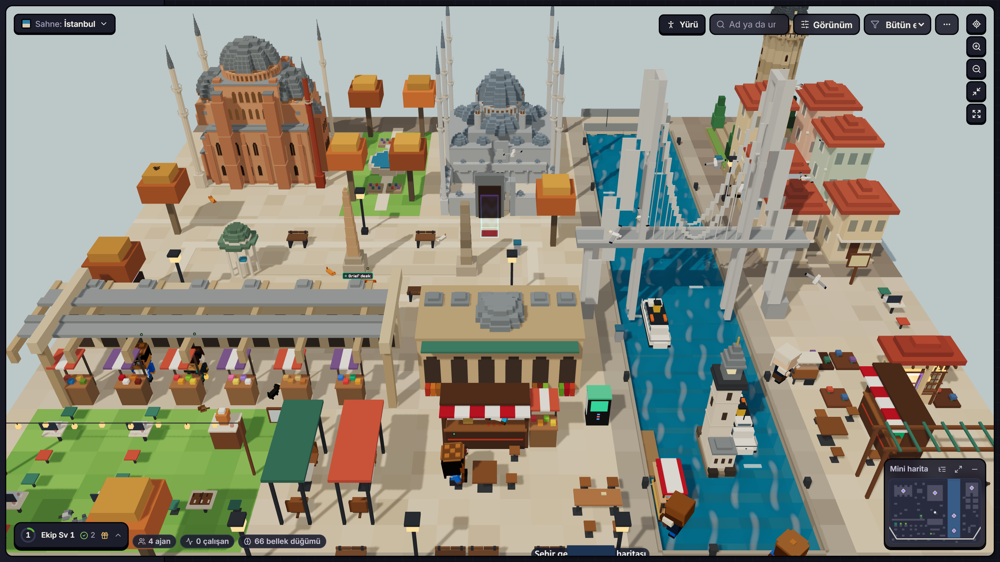
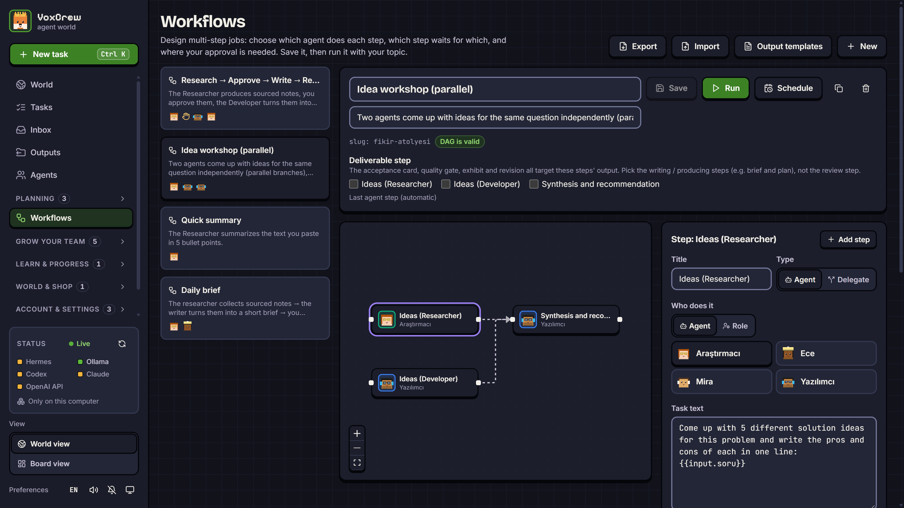

<div align="center">

# VoxCrew

### Yapay zekâ ajanlarına çalışacakları bir dünya ver.

Yapay zekâ ekibin için bilgisayarında çalışan görsel bir çalışma alanı. Ollama, Codex CLI, Claude Code veya kendi model sunucunu bağla; iş akışları çalıştır, ajanlarını voksel dünyada takip et.

**Erken sürüm · 2 aktif ajan · Windows / macOS / Linux · Türkçe / English**

**[Hemen başla](#hizli-baslangic)** · [Model seç](#kullanabileceğin-beyinler) · [Soru sor](https://github.com/Mucaktr/voxcrew/discussions) · [English](README.md)



</div>

VoxCrew kendi bilgisayarında çalışır. Yerel bir model kullanabilir veya kendi hesabınla bir bulut sağlayıcısına bağlanabilirsin. **VoxCrew hesabı gerekmez. Bulut modelleri ve ağ kullanan araçlar veriyi bilgisayarının dışına gönderebilir.**

## Neler yapabilirsin?

- **Ekibini takip et:** ajanların durumunu ve araç kullanımını voksel ofiste gör; İstanbul, Kapadokya ve Londra'yı gez.
- **Tekrarlanabilir işler kur:** paralel görevleri, kendi onayını ve gözden geçirme döngülerini YAML iş akışlarında birleştir.
- **Çalışmayı incele:** durdur, devam ettir, bir adımı yeniden dene, bütçe koy ve işlem izini aç.
- **Ortak bağlamı koru:** tam metin aramalı yerel SQLite grafında bilgileri sakla, sabitle veya geçersiz kıl.

Mevcut modelleriyle görsel bir ortamda çalışmak isteyen bireysel geliştiriciler ve yapay zekâ meraklıları için tasarlandı. Tek kullanıcılı, erken bir sürümdür; [ücretsiz sürümün sınırlarına](#ücretsiz-sürüm-ve-mevcut-sınırlar) göz at.

<a name="hizli-baslangic"></a>
## Hızlı başlangıç

**[Git](https://git-scm.com/downloads)**, **[uv](https://docs.astral.sh/uv/getting-started/installation/)** ve **[Node.js 20+](https://nodejs.org/)** kur. Sonra yeni bir terminal aç. Python 3.11+ yoksa uv indirebilir.

```sh
git clone https://github.com/Mucaktr/voxcrew.git
cd voxcrew
```

**Windows — PowerShell**

```powershell
powershell -NoProfile -ExecutionPolicy Bypass -File .\start.ps1 -Open
```

**macOS / Linux**

```sh
sh ./start.sh --open
```

İlk açılış bağımlılıkları kilit dosyalarından kurar ve arayüzü derler. Tarayıcı açılmazsa **<http://127.0.0.1:7420>** adresine git. Sunucuyu **Ctrl+C** ile durdur.

**Uygulama modelsiz açılır. Ajan çalıştırmak için çalışan bir model bağlantısı gerekir.** Yerel Ollama için indirilmiş model ve yeterli donanım gerekir; bulut sağlayıcılarının kendi hesap, kota ve ücretleri geçerlidir.

[Ayrıntılı kurulum: gereksinimler, Docker, güncelleme ve sorun giderme →](docs/SETUP.tr.md)

### İlk sonucunu al

1. Yerel 18+ onayını ve kurulum sihirbazını tamamla. Gerekirse arayüz dilini Türkçeye çevir.
2. **Bağlantılar** bölümünde modelinin hazır olduğunu kontrol et. **Ajanlar** bölümünde modeli **Araştırmacı**ya ata ve izinlerini gözden geçir.
3. **Ctrl+K**'ya bas, **Araştırmacı**yı seç ve şu örneği yapıştır:

```text
Aşağıdaki metni üç maddede özetle. Yalnızca bu metni kullan;
web'de arama yapma ve dosya değiştirme.

Ekibimiz cuma günü için bir ürün demosu hazırlıyor. Prototip hazır.
Kurulum rehberini kontrol etmemiz ve kısa bir tanıtım videosu çekmemiz gerekiyor.
Ali rehberi kontrol edecek. Deniz perşembe günü videoyu çekecek.
```

4. Çıktıyı ve işlem izini görmek için görevi aç. Beklenen sonuç, verdiğin metnin kısa bir özetidir; kalite kullandığın modele bağlıdır.

Başlangıçtaki **Yazılımcı**, çalışma klasöründe yazma iznine sahiptir. **Araştırmacı** okuma izniyle başlar. Gerçek proje dosyalarıyla çalışmadan önce seçtiğin beynin izin davranışını kontrol et.

## Hazır iş akışlarını dene

Üç örnek, iki dilde hazır gelir. İngilizce arayüz isteklerinde İngilizce örnekler otomatik yüklenir; kendi iş akışların otomatik çevrilmez.

| İş akışı | Ne gösterir? |
|---|---|
| [Hızlı özet](workflows/hizli-ozet.yaml) | Metin yapıştır; Araştırmacıdan beş kısa maddelik özet al. |
| [Fikir atölyesi](workflows/fikir-atolyesi.yaml) | İki paralel fikir listesi ve ardından ortak bir öneri. |
| [Araştır → Onayla → Yaz → Denetle](workflows/arastir-ve-yaz.yaml) | Araştırma notları, senin onayın, taslak ve sınırlı gözden geçirme döngüsü. Araştırma için uygun araçlar ve kaynak kontrolü gerekir. |

| Ajan çalışırken | İş akışı düzenleyicisi |
|---|---|
|  |  |

<details>
<summary>Şehri, işlem izini ve ortak belleği gör</summary>

| Şehirde yürüyüş | Kapadokya |
|---|---|
|  |  |

| İşlem izi | Ortak bellek |
|---|---|
|  |  |

Ekran görüntüleri örnek yapılandırmaları gösterir. Ücretsiz sürümde iki ajan aktif olabilir; ek ajanlar yedekte bekler.

</details>

## Kullanabileceğin beyinler

| Bağlantı | Gerekenler | Araç davranışı |
|---|---|---|
| [Ollama](https://ollama.com/) | Donanımına uygun yerel bir model | Araç destekleyen modeller, araç veya skill atandığında VoxCrew'un araç köprüsünü kullanır. |
| OpenAI uyumlu sunucu veya API | Çalışan yerel sunucu ya da bulut uç noktası ve API anahtarı | Araç desteği modele, uç noktaya ve atanmış MCP araçlarına veya skill'lere bağlıdır. |
| Anthropic API | Kendi API anahtarın | Doğrudan Messages API; Claude Code hesabından ayrıdır. Araçlar yapılandırmaya bağlıdır. |
| [Codex CLI](https://github.com/openai/codex) | Kurulu CLI ve çalışan oturum | Ajan izinleri korumalı alanı belirler; bu bağlayıcı VoxCrew'un araç başına yasak listesini uygulamaz. |
| [Claude Code](https://code.claude.com/docs/en/overview) | Kurulu CLI ve çalışan oturum | Bağlayıcı, araç başına kısıtları Claude Code'a iletir. |
| [Hermes Agent](https://github.com/NousResearch/hermes-agent) (isteğe bağlı) | Mevcut kurulum, profil ve model erişimi | Hermes'in araçlarını ve ayarlarını kullanır; bu bağlayıcı VoxCrew'un araç başına yasak listesini uygulamaz. |

Bulut model kullanımı VoxCrew'a dahil değildir. Sağlayıcının ücret ve kotaları geçerlidir. Tamamen yerel kullanım için hem modellerin **hem araçların** yerel olması gerekir; Ollama seçmek, web aracını çevrimdışı yapmaz.

## Ücretsiz sürüm ve mevcut sınırlar

| İçerik | Sınır veya davranış |
|---|---|
| Aktif ekip | 2 ajan; ek ajanlar yedekte bekler. |
| Hazır şehirler | İstanbul ve Kapadokya; Londra ilk pasaport damganla açılır. |
| Kayıtlı özel iş akışları | 5; hazır örnekler ayrıdır. |
| Aktif zamanlama / özel dünya | 1 zamanlama / 3 özel dünya. |
| Uzak API bağlantıları | 1 adlandırılmış uzak bağlantı; yerel OpenAI uyumlu uç noktalar bu kotaya dahil değildir. |
| Diller | Türkçe ve İngilizce arayüz ve başlangıç örnekleri; nadir sunucu iletileri Türkçe kalabilir. |
| Kurulum | Kaynak kod veya Docker; henüz hazır masaüstü kurulum paketi yok. |

Bu sürüm tek kullanıcılıdır ve yerel kullanım içindir. Loopback adresinde tut; çok kullanıcılı giriş sistemi yoktur. Docker'ın CLI ve ağ sınırları [kurulum rehberinde](docs/SETUP.tr.md#docker) açıklanır.

## Gizlilik ve izinler

- Ayarlar, iş akışları ve bellek yerel veri klasöründe saklanır. [Veri konumlarına](docs/SETUP.tr.md#veri-ve-ortam-degiskenleri) bak.
- Varsayılan olarak kullanım telemetrisi gönderilmez. Bulut modelleri, ağ araçları, model indirmeleri ve açıkça yapılandırılmış OTLP dışa aktarımı ağ isteği yapabilir.
- Ajan çalıştırmadan önce araç ve dosya izinlerini gözden geçir. Görev metni ve model çıktısı izin vermez; yalnızca modele verilen talimatlar bir güvenlik sınırı oluşturmaz.
- Desteklenen haricî CLI ayarlarındaki değişikliklerde önizleme, onay, yedekleme ve geri alma akışı kullanılır.

Sınırlar ve özel güvenlik açığı bildirimi için [güvenlik politikasını](SECURITY.md) oku.

## VoxCrew'un gelişimine katıl

- **İlk deneme:** [Discussions bölümünde](https://github.com/Mucaktr/voxcrew/discussions) işletim sistemini, seçtiğin beyni ve takıldığın adımı paylaş. Sırları ve kişisel yolları çıkar.
- **Hata veya özellik fikri:** [Issue aç](https://github.com/Mucaktr/voxcrew/issues/new/choose).
- **Katkı:** [Belge, çeviri veya dışa aktarılmış dünyalarla](CONTRIBUTING.tr.md) başlayabilirsin.
- **Gelişmeleri takip et:** Depoyu yıldızlayarak kaydet ve faydalı bulduğun bir iş akışını paylaş.

## Lisans

Geliştiren: Mustafa Uçak. Kaynak kod, rekabet kısıtı içeren **[PolyForm Shield License 1.0.0](LICENSE)** altında sunulur. Kullanım veya dağıtım öncesinde lisansı incele. [Üçüncü taraf bildirimleri](THIRD_PARTY_NOTICES.md).

VoxCrew; Nous Research, OpenAI, Anthropic veya Ollama ile bağlantılı değildir. Ürün adları uyumluluğu anlatır; ticari markalar ilgili sahiplerine aittir.
