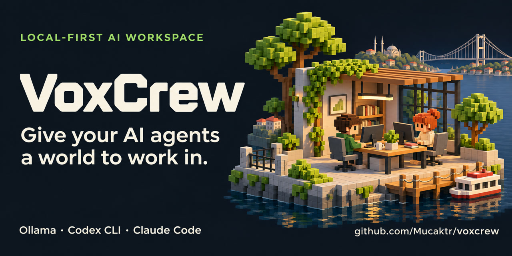

# VoxCrew media kit

**English** · [Türkçe](#türkçe)

VoxCrew is a local-first visual workspace for AI agents. Bring your own model connection, assign tasks, inspect results and explore a voxel world. The public free edition supports two active agents. Source is available under [PolyForm Shield 1.0.0](../LICENSE), which includes a noncompete restriction.

**[Project](https://github.com/Mucaktr/voxcrew)** · [Website](https://mucaktr.github.io/voxcrew/) · [Setup](SETUP.md)

## Cover

[Download the 1280 × 640 JPEG](assets/voxcrew-cover.jpg?raw=1). This is an AI-generated brand illustration. The videos below are recordings of the actual app. Please keep that distinction when presenting the project.

## Videos

| Video | Length | What it shows |
|---|---|---|
| [Main demo](media/voxcrew-demo.mp4?raw=1) | 42 sec | A real Ollama summary task, then Istanbul, Cappadocia and London. |
| [Take a break](media/voxcrew-breaks-40s.mp4?raw=1) · [SRT](media/voxcrew-breaks-40s.srt) | 40 sec | Fishing, an anchovy catch, tea and sharing a simit with seagulls. |
| [Landmarks](media/voxcrew-landmarks-36s.mp4?raw=1) · [SRT](media/voxcrew-landmarks-36s.srt) | 36 sec | Istanbul landmarks, Cappadocia and London's riverside. |
| [Agents and menus](media/voxcrew-agent-menus-81s.mp4?raw=1) · [SRT](media/voxcrew-agent-menus-81s.srt) | 81 sec | A real task, its result and trace, shared memory, and previews of workflow, scheduling and export controls. |

All four videos are silent H.264 MP4 files, 1280 × 800 at 30 fps. The three detail videos have English and Turkish captions. Waiting and navigation are shortened; retained clips keep their recorded timing. [Main demo recording notes](media/DEMO.md).

The main demo's task took **3 min 41 sec / 2,256 app-reported tokens**. The task in the agent-menu video is a separate run: **1 min 16 sec / 1,023 tokens**. These are individual local runs using Ollama `qwen3:4b`, not benchmarks. Workflow, scheduling and export previews do not show those flows being executed.

## Short introduction

> Give your AI agents a world to work in. VoxCrew brings model connections, tasks, visual workflows and shared memory into a local voxel workspace. Try the free two-agent edition with your own model and tell us how your first task went.

Hosted model usage is not included. The app targets Windows, macOS and Linux; see the current release's validation notes for what was actually checked. No prebuilt desktop installer is provided.

## Türkçe

VoxCrew, yapay zekâ ajanları için bilgisayarında çalışan görsel bir çalışma alanı. Kendi model bağlantını kullan; görev ver, sonucu ve işlem izini incele, voksel dünyayı keşfet. Ücretsiz sürüm **iki aktif ajan** içerir. Kaynak kodu, rekabet kısıtı içeren **PolyForm Shield 1.0.0** lisansıyla sunulur.

Kapak, yapay zekâyla üretilmiş marka illüstrasyonudur; dört video gerçek uygulama kaydıdır. Videolar sessizdir; üç ayrıntı videosu Türkçe ve İngilizce açıklamalıdır. Bekleme ve gezinme bölümleri kısaltılmıştır. Ana demodaki görev **3 dakika 41 saniye / 2.256 token**, ayrı ajan videosundaki görev **1 dakika 16 saniye / 1.023 token** sürmüştür. Bu değerler tekil yerel çalışmaları anlatır; performans karşılaştırması değildir. İş akışı, zamanlama ve dışa aktarma bölümleri menü önizlemesidir.

> Yapay zekâ ajanlarına çalışacakları bir dünya ver. VoxCrew; model bağlantılarını, görevleri, görsel iş akışlarını ve ortak hafızayı yerel bir voksel çalışma alanında birleştiriyor. Kendi modelinle ücretsiz iki ajanlı sürümü dene, ilk görevinin nasıl geçtiğini paylaş.

[Türkçe tanıtım sayfası](https://mucaktr.github.io/voxcrew/tr.html) · [Türkçe kurulum](SETUP.tr.md) · [Geri bildirim](https://github.com/Mucaktr/voxcrew/discussions)
